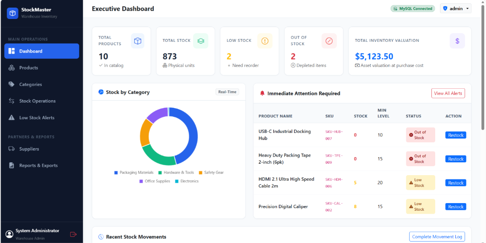
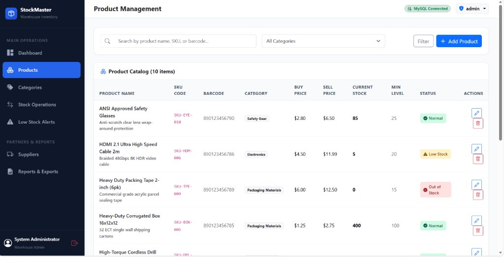
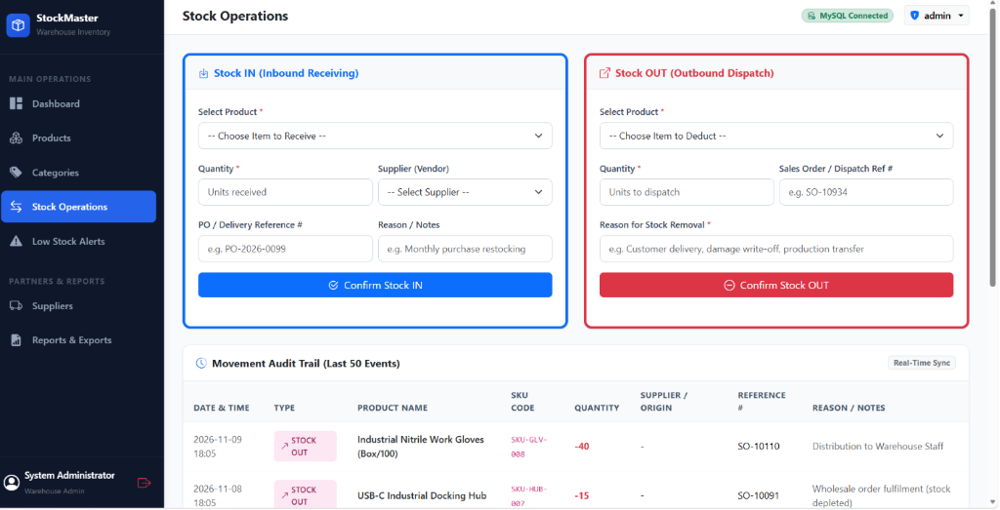
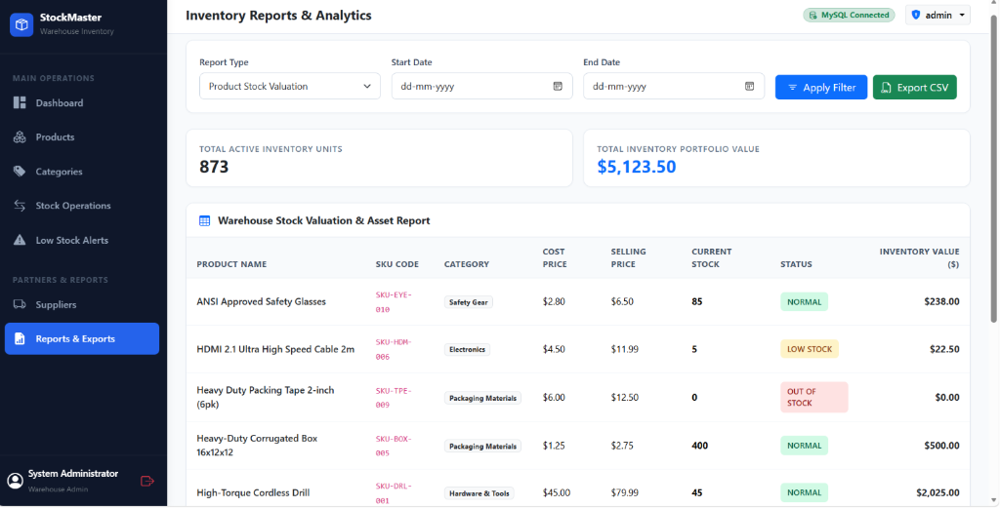

# 📦 Warehouse Inventory Management System

[](https://www.oracle.com/java/)
[](https://jakarta.ee/)
[](https://tomcat.apache.org/)
[](https://www.mysql.com/)
[](https://getbootstrap.com/)
[](LICENSE)

An enterprise-grade, web-based **Warehouse Inventory Management System** built with **Core Java, Java Servlets (Jakarta EE 10), JDBC, JSP, MySQL 8.4, and Bootstrap 5**, deployed on **Apache Tomcat 10.1**.

Designed as a complete, production-ready college B.Tech capstone project demonstrating clean **Model-View-Controller (MVC)** architecture, transactional consistency, session management, and real-time dashboard analytics without relying on heavy frameworks.

---

## 📑 Table of Contents

- [Overview](#-overview)
- [Key Features](#-key-features)
- [Technology Stack](#-technology-stack)
- [Project Architecture](#-project-architecture)
- [Project Directory Structure](#-project-directory-structure)
- [Database Schema & ER Details](#-database-schema--er-details)
- [Prerequisites](#-prerequisites)
- [Step-by-Step Installation & Setup](#-step-by-step-installation--setup)
  - [1. Clone Repository](#1-clone-repository)
  - [2. Database Setup](#2-database-setup)
  - [3. Configure Environment Variables](#3-configure-environment-variables)
  - [4. Build the Project with Maven](#4-build-the-project-with-maven)
  - [5. Deploy to Apache Tomcat 10.1](#5-deploy-to-apache-tomcat-101)
- [Default Administrator Login](#-default-administrator-login)
- [Screenshots](#-screenshots)
- [Testing & Viva Demonstration Scenarios](#-testing--viva-demonstration-scenarios)
- [Future Enhancements](#-future-enhancements)
- [License](#-license)
- [Author & Acknowledgments](#-author--acknowledgments)

---

## 🌟 Overview

Effective inventory control is critical for modern logistics, retail, and manufacturing warehouses. This project provides warehouse managers and administrators with an end-to-end management platform to:
- Monitor stock levels in real-time across categories.
- Record inbound stock receipts (**Stock IN**) and outbound order dispatches (**Stock OUT**) with strict transaction locking.
- Prevent inventory deficits and negative stock errors at the database layer.
- Automatically detect and surface **Low Stock** and **Out of Stock** alerts before inventory depletion occurs.
- Generate and export inventory valuation ledgers and transaction audit reports to CSV format.

---

## ✨ Key Features

### 📊 1. Executive Dashboard
- **Live KPI Summary**: Real-time counts of Total Products, Physical Stock Units, Low Stock items, Out of Stock items, and Total Inventory Valuation computed directly from MySQL.
- **Stock by Category Chart**: Dynamic interactive doughnut chart powered by Chart.js.
- **Recent Movements Log**: Audit log of the latest inventory events.
- **Action Watchlist**: Prominently displays items requiring immediate replenishment.

### 📦 2. Product & SKU Management
- Catalog management supporting SKU codes, barcodes (EAN/UPC), categories, cost prices, selling prices, current stock, and minimum safety thresholds.
- **Unique SKU Enforcement**: Server-side uniqueness verification prevents duplicate SKU entries.
- Real-time search by product name, SKU, or barcode, with category filtering.

### 🏷️ 3. Category Management
- Categorize warehouse inventory by classifications (e.g., Electronics, Hardware, Office Supplies, Safety Gear).
- Displays live product association count per category.
- Foreign key protection prevents accidental deletion of categories containing active products.

### 🔄 4. Transactional Stock Management (IN / OUT)
- **Stock IN (Inbound Receiving)**: Select product, enter quantity, assign supplier/vendor, enter purchase order reference, and update stock atomically.
- **Stock OUT (Outbound Dispatch)**: Deduct inventory with recorded reason (sales dispatch, internal transfer, damage write-off).
- **Negative Stock Prevention**: Uses atomic SQL update queries with condition checks (`current_stock >= requested_quantity`) inside JDBC transactions (`setAutoCommit(false)`, `commit()`, `rollback()`).

### ⚠️ 5. Automated Low-Stock & Out-of-Stock Alerts
- **OUT OF STOCK** (Red status): When `current_stock == 0`.
- **LOW STOCK** (Amber warning status): When `current_stock <= min_stock_level`.
- **NORMAL** (Green status): When `current_stock > min_stock_level`.
- One-click **Restock** shortcut redirects directly to the Stock IN form.

### 🚚 6. Supplier Directory
- Manage vendor contact persons, phone numbers, email addresses, and warehouse locations.
- Connects suppliers directly to Stock IN purchase history.

### 📈 7. Reports & CSV Export
- Comprehensive reports for **Stock Valuation**, **Stock IN Movement**, and **Stock OUT Dispatch**.
- Date range filtering (`startDate` to `endDate`).
- **One-Click CSV Export**: Streams formatted spreadsheet files directly to the browser.

### 🔒 8. Security & Session Protection
- **BCrypt Password Hashing**: Passwords stored securely via standard jBCrypt algorithms.
- **Servlet Filters**: `AuthenticationFilter` guards all admin endpoints.
- **Cache-Control Headers**: Disables browser caching of protected views to prevent back-button access after logout.

---

## 🛠 Technology Stack

| Layer | Technologies |
| :--- | :--- |
| **Backend Language** | Core Java (JDK 17 / 21 / 24 compatible) |
| **Web Tier** | Jakarta Servlets 6.0, Jakarta JSP 3.1, JSTL 3.0 |
| **Database Access** | Native JDBC (`java.sql.PreparedStatement`, Transactions) |
| **Database Server** | MySQL 8.0 / MySQL 8.4 LTS |
| **Application Server** | Apache Tomcat 10.1+ |
| **Build & Dependency Tool** | Apache Maven 3.9+ / 3.10+ |
| **Frontend UI** | HTML5, CSS3, Bootstrap 5.3, Bootstrap Icons 1.11 |
| **Data Visualization** | Chart.js 4.4 |
| **Security** | jBCrypt 0.4, Jakarta Servlet Filters, HTTPSession |

---

## 🏛 Project Architecture

This application strictly implements the **Model-View-Controller (MVC)** design pattern:

```
                            HTTP Request
                                 │
                                 ▼
                     ┌───────────────────────┐
                     │ AuthenticationFilter  │  (Session & Security Gate)
                     └───────────┬───────────┘
                                 │ Authorized
                                 ▼
                        ┌─────────────────┐
                        │ Servlet Layer   │  (Controller)
                        │ (HTTP Handlers) │
                        └────────┬────────┘
                                 │ Calls
                                 ▼
                        ┌─────────────────┐
                        │   DAO Layer     │  (Data Access Object)
                        │ (PreparedStatement)
                        └────────┬────────┘
                                 │ JDBC
                                 ▼
                        ┌─────────────────┐
                        │  MySQL Database │  (inventory_management)
                        └─────────────────┘
                                 │ ResultSets / Entities
                                 ▼
                        ┌─────────────────┐
                        │   Model Layer   │  (JavaBeans: Product, Category, etc.)
                        └────────┬────────┘
                                 │ Forward
                                 ▼
                        ┌─────────────────┐
                        │    JSP Views    │  (HTML5 + Bootstrap 5 + JSTL)
                        └─────────────────┘
```

---

## 📁 Project Directory Structure

```
InventoryManagementSystem/
│
├── src/main/java/com/inventory/
│   ├── model/                         # Domain Entities (JavaBeans)
│   │   ├── Admin.java
│   │   ├── Category.java
│   │   ├── Product.java
│   │   ├── StockTransaction.java
│   │   └── Supplier.java
│   │
│   ├── dao/                           # JDBC Database Access Objects
│   │   ├── AdminDAO.java
│   │   ├── CategoryDAO.java
│   │   ├── ProductDAO.java
│   │   ├── StockDAO.java
│   │   └── SupplierDAO.java
│   │
│   ├── servlet/                       # HTTP Controllers
│   │   ├── AlertServlet.java
│   │   ├── CategoryServlet.java
│   │   ├── DashboardServlet.java
│   │   ├── LoginServlet.java
│   │   ├── ProductServlet.java
│   │   ├── ReportServlet.java
│   │   ├── StockServlet.java
│   │   └── SupplierServlet.java
│   │
│   ├── filter/                        # Security & Session Interceptors
│   │   └── AuthenticationFilter.java
│   │
│   └── util/                          # Reusable Utilities
│       ├── DBConnection.java          # MySQL JDBC Connection Manager
│       └── PasswordUtil.java          # BCrypt Hashing & Verification
│
├── src/main/webapp/
│   ├── assets/
│   │   ├── css/style.css              # Custom Navy & White SaaS Stylesheet
│   │   └── js/
│   │       ├── dashboard.js           # Chart.js integration
│   │       └── main.js                # Form validation & modals
│   │
│   ├── WEB-INF/
│   │   ├── web.xml                    # Servlet 6.0 deployment descriptor
│   │   └── views/                     # Protected JSP Views
│   │       ├── common/
│   │       │   ├── header.jsp
│   │       │   ├── sidebar.jsp
│   │       │   └── footer.jsp
│   │       ├── alerts.jsp
│   │       ├── categories.jsp
│   │       ├── dashboard.jsp
│   │       ├── products.jsp
│   │       ├── reports.jsp
│   │       ├── stock.jsp
│   │       └── suppliers.jsp
│   │
│   ├── index.jsp                      # Application entry-point router
│   └── login.jsp                      # Admin login interface
│
├── database.sql                       # MySQL 8.x schema & seed dataset
├── .env.example                       # Environment variables template
├── .gitignore                         # Git exclusion rules
├── CONTRIBUTING.md                    # Contribution guidelines
├── LICENSE                            # MIT License
├── pom.xml                            # Maven project object model
└── README.md                          # Documentation
```

---

## 🗄 Database Schema & ER Details

The database `inventory_management` comprises 5 relational tables:

```
┌──────────────┐         ┌─────────────────────┐
│  categories  │ 1     * │      products       │
├──────────────┤─────────┼─────────────────────┤
│ category_id  │         │ product_id (PK)     │
│ category_name│         │ product_name        │
│ description  │         │ sku_code (UNIQUE)   │
│ created_at   │         │ category_id (FK)    │
└──────────────┘         │ current_stock       │
                         │ min_stock_level     │
                         └──────────┬──────────┘
                                    │ 1
                                    │
                                    │ *
┌──────────────┐         ┌──────────┴──────────┐
│  suppliers   │ 1     * │  stock_transactions │
├──────────────┤─────────┼─────────────────────┤
│ supplier_id  │         │ transaction_id (PK) │
│ supplier_name│         │ product_id (FK)     │
│ contact_name │         │ transaction_type    │
│ phone / email│         │ quantity            │
└──────────────┘         │ supplier_id (FK)    │
                         │ reference_number    │
                         │ reason              │
                         │ transaction_date    │
                         └─────────────────────┘
```

1. **`admin`**: Stores administrative accounts, BCrypt password hashes, and profile emails.
2. **`categories`**: Logical groupings for inventory items.
3. **`suppliers`**: Vendors and supply-chain procurement partners.
4. **`products`**: Inventory records with SKU codes, barcodes, unit prices, current stock, and safety thresholds.
5. **`stock_transactions`**: Complete historical audit trail of every inbound and outbound movement.

---

## ⚙️ Prerequisites

Ensure the following tools are installed on your workstation:

- **Java Development Kit (JDK)**: Version 17 or higher (JDK 17, 21, or 24 supported).
- **Apache Maven**: Version 3.9.0 or higher.
- **MySQL Server**: Version 8.0 or 8.4 LTS.
- **Apache Tomcat**: Version 10.1.x (Tomcat 10.1 is required for `jakarta.servlet` namespace).

---

## 🚀 Step-by-Step Installation & Setup

### 1. Clone Repository
```bash
git clone https://github.com/shaikminhazuddin/inventory-management-system.git
cd inventory-management-system
```

### 2. Database Setup
1. Log into your MySQL console or MySQL Workbench:
   ```bash
   mysql -u root -p
   ```
2. Import the provided SQL script:
   ```sql
   SOURCE D:/Inventory Management System/database.sql;
   ```
   *(Or run via command line: `mysql -u root -p < database.sql`)*.
3. This creates the database `inventory_management`, builds all tables, foreign keys, and indexes, and inserts rich seed records.

### 3. Configure Environment Variables
Copy the template `.env.example` to `.env` or set environment variables in your OS:

```bash
cp .env.example .env
```

Edit `.env` (or set OS variables) to match your local MySQL configuration:
```env
DB_URL=jdbc:mysql://localhost:3306/inventory_management?useSSL=false&allowPublicKeyRetrieval=true&serverTimezone=UTC&createDatabaseIfNotExist=true
DB_USER=root
DB_PASSWORD=your_mysql_password_here
```

> **Note:** The application reads from:
> 1. OS Environment Variables (`DB_URL`, `DB_USER`, `DB_PASSWORD`)
> 2. JVM System Properties (`-DDB_PASSWORD=...`)
> 3. Local `.env` file (which is git-ignored)

### 4. Build the Project with Maven
Open terminal inside the project root and execute:

```bash
mvn clean package
```

Upon completion, you will see `BUILD SUCCESS` and the WAR file will be generated at:
```text
target/InventoryManagementSystem.war
```

### 5. Deploy to Apache Tomcat 10.1
1. Copy the generated `InventoryManagementSystem.war` to your Tomcat `webapps/` folder:
   ```bash
   # Windows PowerShell
   Copy-Item "target\InventoryManagementSystem.war" -Destination "C:\apache-tomcat-10.1.x\webapps\"

   # Linux / macOS
   cp target/InventoryManagementSystem.war /opt/tomcat10/webapps/
   ```
2. Start Apache Tomcat:
   - **Windows**: `C:\apache-tomcat-10.1.x\bin\startup.bat`
   - **Linux / macOS**: `/opt/tomcat10/bin/startup.sh`
3. Access the application in your browser:
   ```text
   http://localhost:8080/InventoryManagementSystem/
   ```

---

## 🔑 Default Administrator Login

The application is pre-seeded with a default administrator account:

| Attribute | Value |
| :--- | :--- |
| **Login URL** | `http://localhost:8080/InventoryManagementSystem/login.jsp` |
| **Username** | `admin` |
| **Password** | `admin123` |
| **Role** | System Administrator |

---

## 🖼 Screenshots

| Executive Dashboard | Product Management |
| :---: | :---: |
|  |  |

| Stock Operations (Inbound & Outbound) | Inventory Reports & Analytics |
| :---: | :---: |
|  |  |

---

## 🧪 Testing & Viva Demonstration Scenarios

When demonstrating this project for academic evaluation or viva defense:

1. **Authentication Gate**: Attempt to access `http://localhost:8080/InventoryManagementSystem/dashboard` directly without logging in. Verify redirection to `login.jsp?msg=auth_required`.
2. **Unique SKU Validation**: Try adding a product with an existing SKU (e.g. `SKU-DRL-001`). The system rejects the operation and displays a duplicate error alert.
3. **Transactional Stock IN**: Perform Stock IN for an item. Demonstrate that `current_stock` increments in the catalog and an audit log entry is written to `stock_transactions`.
4. **Negative Stock Prevention**: Attempt to dispatch (Stock OUT) more units than available in stock. The transaction is aborted and rolled back with an "Insufficient stock" warning.
5. **Dynamic Alert Transition**: Deduct stock until quantity drops below `min_stock_level`. Navigate to **Low Stock Alerts** to show the item highlighted in warning amber. Deplete the stock to 0 to show the critical red **OUT OF STOCK** badge.
6. **Live CSV Export**: Go to Reports, select date ranges, and click **Export CSV** to verify direct download of the inventory valuation report.

---

## 🔮 Future Enhancements

- [ ] **Multi-Warehouse Support**: Tracking stock by specific warehouse aisles, racks, and bin locations.
- [ ] **Barcode Scanner Integration**: USB/Bluetooth hardware scanner input for rapid stock checkouts.
- [ ] **Automated Email Notifications**: SMTP email alerts sent automatically to purchasing managers when stock hits reorder thresholds.
- [ ] **Role-Based Access Control (RBAC)**: Distinct permissions for Warehouse Staff, Inventory Managers, and System Admins.
- [ ] **Purchase Order Approval Workflow**: Multi-tier PO generation and approval before receiving.

---

## 📄 License

This project is licensed under the [MIT License](LICENSE).

---

## 👨‍💻 Author & Acknowledgments

- **Developed by**: [Shaik Minhazuddin](https://github.com/shaikminhazuddin)
- **Degree / College**: B.Tech in Computer Science & Engineering
- **Special Thanks**: Academic mentors, laboratory guides, and open-source contributors of Apache Tomcat, MySQL, and Bootstrap.
